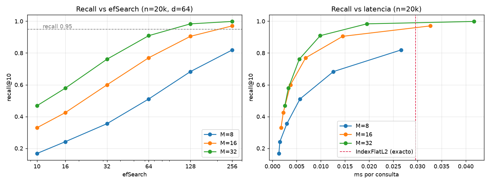
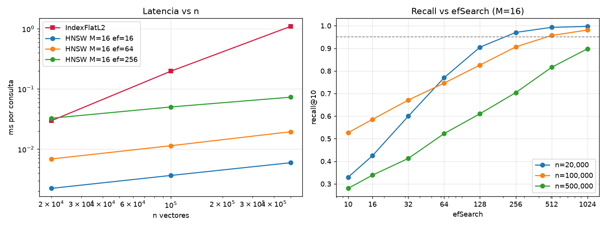

# Respuestas del workshop RAG

**Jerónimo Zapata Cuadros** (`JCuAdrox`) · SI3003 Inteligencia Artificial, EAFIT

> **Estado de la ejecución (22 oct 2026).** El notebook `04_challenges.ipynb` está ejecutado con salidas reales (T1, experimento de escala del umbral, C1 y la verificación de palabras clave de C4). Los notebooks `02b` y `03`, y las partes de C4/C6 que llaman a la API, **están implementados pero todavía no se han ejecutado contra NVIDIA NIM**, porque en el equipo donde se preparó la entrega no estaba definida la variable `NVIDIA_API_KEY`. Las secciones que dependen de esas salidas dicen **«Pendiente de ejecución»** y no traen números inventados. Para completarlas basta con definir la variable de entorno y correr `python scripts/run_notebooks.py`, que ejecuta los tres notebooks con `nbclient`, toma las capturas de Gradio con Playwright y revisa que no haya ninguna key en las salidas.
>
> Todo el código de 02b/03/04 se probó de punta a punta con modelos simulados en una copia aparte (sin guardar esas salidas): los tres notebooks terminan sin errores, las cuatro capturas de Gradio se generan, y C6 reabre la colección persistida desde un proceso nuevo.

---

# Bloque 0 · Teoría

## T1 · Cuántos nodos viven en cada capa

_Evidencia:_ [`notebooks/04_challenges.ipynb`](notebooks/04_challenges.ipynb), sección T1 (salida guardada).

**A mano.** Con $l=\lfloor -\ln(U)\,m_L\rfloor$ y $m_L = 1/\ln M$, un nodo llega a la capa $k$ o más si $-\ln(U)/\ln M \ge k$, es decir si $U \le M^{-k}$; como $U$ es uniforme, $P(l\ge k)=M^{-k}$. Con $M=16$ y $N=10^6$:

| capa ≥ k | cálculo | esperado | simulado (semilla 2026) | media ± desv. de 20 corridas |
|---|---|---:|---:|---:|
| ≥ 1 | 10⁶ / 16 | 62 500 | 62 512 | 62 587 ± 270 |
| ≥ 2 | 10⁶ / 256 | 3 906.25 | 3 977 | 3 893 ± 80 |
| ≥ 3 | 10⁶ / 4 096 | 244.14 | 254 | 244.6 ± 17 |

$m_L = 1/\ln 16 = 0.3607$. En la simulación el 93.75 % de los nodos vive solo en la capa 0 (justo $1-1/16$) y la capa más alta es la 5. El error relativo crece al subir de capa (+0.0 %, +1.8 %, +4.0 %; +24.5 % en la capa 4, donde se esperan solo 15 nodos) porque hay pocos eventos, no porque falle la fórmula: el promedio de 20 corridas queda pegado al valor teórico.

**¿Por qué conviene que haya pocos hubs arriba?** Las capas altas funcionan como autopistas: con pocos nodos muy separados, la búsqueda voraz con ef=1 cruza el espacio en pocos saltos y llega a la región correcta en unas $O(\log N)$ comparaciones. Si las capas altas fueran tan densas como la capa 0, cada salto avanzaría poco, se perdería la ventaja jerárquica y además se pagaría más memoria y más tiempo de inserción por las aristas extra.

## T2 · ef, k y el tamaño de la cola

_Evidencia:_ `hnsw_busqueda.html` (sección «ef y recall») y los datos de C1.

- **k=10 con ef=5:** la cola de candidatos de la capa 0 solo guarda 5 elementos, así que es imposible devolver 10 vecinos. En la teoría la búsqueda devuelve como mucho 5; en la práctica algunas librerías (hnswlib, FAISS) suben ef en silencio a `max(ef, k)`, y entonces el ef que uno cree estar usando no es el real. Por eso debe cumplirse siempre **ef ≥ k**.
- **Valor inicial:** la regla práctica de la presentación es **ef = 2·k** (20 para k=10). Se sube cuando el recall medido frente a una búsqueda exacta sobre una muestra de consultas queda por debajo del objetivo, por ejemplo 0.95. Mis datos de C1 muestran que la regla es solo un punto de partida: con M=16 y n=20 000 vectores aleatorios, ef=16 da recall@10 = 0.425 y hay que llegar a ef=256 para tener 0.971.
- **¿Cuál se cambia en producción?** **ef** (efSearch) es un parámetro de consulta y se puede cambiar en cada búsqueda sin reconstruir nada; en C1 cambio `index.hnsw.efSearch` sobre el mismo índice. **ef_construction** define cómo se cablearon las aristas al insertar; cambiarlo exige reconstruir el índice.

## T3 · Inserción frente a búsqueda

_Evidencia:_ `hnsw_insercion.html` y `hnsw_busqueda.html`.

| | Inserción | Búsqueda | Por qué |
|---|---|---|---|
| ¿Se sortea la capa? | Sí, $l=\lfloor-\ln U\cdot m_L\rfloor$ | No | Al insertar hay que decidir hasta qué capa existe el nodo nuevo; al buscar, la consulta no se guarda, así que no necesita capa: siempre entra por el nodo de entrada global de la capa más alta. |
| ef en las capas altas | ef = 1 (voraz) desde la capa máxima hasta $l+1$ | ef = 1 (voraz) desde la capa máxima hasta la 1 | En ambos casos las capas altas solo sirven para llegar rápido a la zona correcta; ahí no importa la precisión. |
| Parámetro de la fase principal | **ef_construction**, desde la capa $l$ hasta la 0 | **ef** (efSearch), solo en la capa 0 | Al insertar, una cola grande permite elegir buenos M vecinos en cada capa donde vive el nodo; al buscar, la cola de ef candidatos define el balance recall/latencia. |
| ¿Modifica el índice? | Sí: crea aristas (y poda las de los vecinos) | No: solo lee | Insertar cambia el grafo; buscar es de solo lectura, por eso ef se puede cambiar en caliente. |

En los notebooks, `vectorstore.add_documents(...)` dispara la **inserción**: calcula los embeddings de los chunks y hace *upsert* de los puntos en Qdrant. `retriever.invoke(...)` dispara la **búsqueda**: calcula el embedding de la consulta y pide los k vecinos. Un matiz que verifiqué leyendo el código de `qdrant-client` 1.20.0: con `QdrantClient(":memory:")` o `path=...` (modo local), Qdrant **no construye HNSW**. `local_collection.search` calcula la distancia contra todos los vectores con numpy y ordena con `argsort`, o sea que es fuerza bruta exacta aunque la colección reporte `hnsw_config`. El grafo HNSW solo existe en el servidor de Qdrant. Para corpus de 150 a 330 chunks como los de este taller da igual; para millones de vectores no.

## T4 · El invariante de FAISSVectorStore

_Evidencia:_ `faiss_explicado.html` (pestaña «El invariante»).

El store guarda en paralelo el índice FAISS (solo vectores, posición *i*) y `self.documents` (el objeto en la posición *i*). Si se borra B solo de `self.documents`, FAISS sigue teniendo 4 vectores y la búsqueda sigue devolviendo enteros sobre el índice viejo:

| Posición FAISS | Vector guardado | `documents[i]` antes | `documents[i]` después de borrar B |
|---:|---|---|---|
| 0 | vec(A) | A | A |
| 1 | vec(B) | B | **C** |
| 2 | vec(C) | C | **D** |
| 3 | vec(D) | D | **IndexError** (la lista ya solo tiene 3) |

Una búsqueda que antes devolvía `[1, 2, 3]` → `[B, C, D]` ahora intenta devolver `[C, D, ?]`:

- `idx 1 → C` e `idx 2 → D` son **errores silenciosos**: el código no falla, pero entrega el documento equivocado con el score de otro vector. En un RAG eso significa citar una fuente que no dice lo que el modelo afirma, y nadie se entera.
- `idx 3 → documents[3]` **lanza `IndexError`**, porque la lista tiene longitud 3.

El error silencioso es el peligroso. `faiss.IndexFlatIP` no tiene borrado y toda la correspondencia depende de la posición. Por eso se usan bases vectoriales como Qdrant: cada punto tiene un **id estable** y su payload (título, source, chunk_index) se guarda **junto al vector**. Borrar o actualizar un punto es una operación nativa que mantiene sincronizados vector, metadata e índice, así que no hay una lista paralela que se pueda desalinear.

## T5 · El costo de la fuerza bruta

_Evidencia:_ cálculo propio y tiempos medidos en C1.

- Multiplicaciones por consulta: $10^6 \times 768 = 7.68\times10^{8}$.
- A 100 consultas/s: $7.68\times10^{8}\times 10^{2} = \mathbf{7.68\times10^{10}}$ **multiplicaciones por segundo** (y otras tantas sumas, ≈ 1.5 × 10¹¹ FLOP/s).
- Lo más limitante es la memoria: los vectores ocupan $10^6 \times 768 \times 4$ B ≈ 3.07 GB en float32, y cada consulta exacta tiene que leerlos todos. A 100 consultas/s eso es ≈ 307 GB/s de lectura de RAM, muy por encima del ancho de banda de un servidor normal, y el costo crece linealmente con n.

**¿Por qué deja de ser viable ser exacto?** El costo por consulta es O(n·d). Cada vector nuevo encarece todas las consultas futuras, y con millones de vectores y tráfico real la latencia y el hardware se disparan. En C1 lo medí a escala pequeña (d=64): la búsqueda exacta pasó de 0.030 ms/consulta con 20 000 vectores a 0.198 ms con 100 000 y 1.094 ms con 500 000, casi proporcional a n.

**¿Qué se sacrifica y qué se gana con ANN?** Se sacrifica exactitud: el recall deja de ser 1 y algunos vecinos verdaderos se pierden. También se paga memoria extra por las aristas del grafo y tiempo de construcción (14.97 s para 500 000 vectores con M=16 en C1). A cambio, el costo de consulta crece de forma sublineal (≈ log n) y es ajustable con ef. Con 500 000 vectores, HNSW con ef=64 respondió en 0.019 ms (56× más rápido que el exacto) pero con recall 0.52, y con ef=1024 en 0.36 ms (3.0×) con recall 0.90. Es decir, ef es la perilla que mueve el punto en esa curva.

---

# Bloque A · App RAG empresarial

## A1 · Ejecuta la app RAG de punta a punta

_Evidencia:_ [`notebooks/02b_rag_app_nvidia_nim_colab.ipynb`](notebooks/02b_rag_app_nvidia_nim_colab.ipynb) (secciones 1–5) · `evidencias/A1_gradio.png` (pendiente).

**Lo que está hecho:** copia del 02b con los 4 `DEMO_DOCUMENTS`, la ruta corregida (`ROOT / "data" / "company_documents.json"` en lugar de `Path("company_documents.json")`), los modelos del enunciado, `enable_thinking=False`, el envoltorio `ResilientEmbeddings` (timeout de 12 s, 6 reintentos con backoff y caché de consultas y chunks) y una celda que hace las 4 preguntas de ejemplo más una fuera de contexto («¿Quién ganó el Mundial de fútbol de 2022?»), imprime la tabla y lanza Gradio con `prevent_thread_lock=True` en `127.0.0.1:7861` para la captura. También hay una celda que verifica el problema de Nemotron 3.5: hace la misma pregunta con y sin razonamiento y un presupuesto de 120 tokens, y muestra `finish_reason`, el largo de `content` y el largo de `reasoning_content`.

**Pendiente de ejecución:** la tabla de 5 preguntas, la verificación con y sin razonamiento, y la captura.

## A2 · Tu propio corpus de documentos

_Evidencia:_ [`data/company_documents.json`](data/company_documents.json) · notebook 02b, sección 6 · `evidencias/A2_corpus.png` (pendiente).

**Corpus:** *Roca Viva*, un centro de escalada ficticio en Medellín. Tiene 9 documentos con `id`, `title`, `content` y metadata de dos claves, `area` (ventas, seguridad, operaciones, formacion, comunidad) y `tipo` (tarifas, politica, procedimiento, reglamento, horarios, cursos, tienda, protocolo, eventos). Cada documento mezcla entre 5 y 7 datos concretos, como precios, edades, horarios y plazos, para que la recuperación tenga que encontrar un dato puntual dentro de un texto con otros datos parecidos.

**Preguntas:**

| # | Pregunta | ¿Respondible? | Respuesta esperada (del JSON) |
|---|---|---|---|
| 1 | ¿Cuánto cuesta el plan Pared Libre? | sí | $189.000 COP al mes |
| 2 | ¿Un adolescente de 15 años puede escalar solo? | sí | Sí, solo en boulder y con consentimiento firmado por un acudiente |
| 3 | ¿Qué evalúa el examen de la certificación de aseguramiento? | sí | Nudo ocho doble, chequeo cruzado y aseguramiento con GriGri |
| 4 | ¿A qué hora cierra Roca Viva los domingos? | sí | 5:00 p. m. (último ingreso 45 min antes) |
| 5 | ¿Por cuánto tiempo puedo congelar mi membresía mensual? | sí | Entre 15 y 60 días, una vez al año (90 con incapacidad médica) |
| 6 | ¿Roca Viva tiene piscina o sauna? | no | — |
| 7 | ¿Cuánto gana al mes un instructor de Roca Viva? | no | — (trampa: los instructores sí aparecen, el salario no) |

**chunk_size: datos ya medidos (no dependen de la API).** Los documentos tienen entre 411 y 565 caracteres (media de 485). Con overlap del 10 % el splitter produce:

| chunk_size | chunks | caracteres por chunk (media) |
|---:|---:|---:|
| 200 | 30 | 146 |
| 300 | 18 | 245 |
| 400 | 18 | 245 |
| 600 | 9 | 485 |
| 900 | 9 | 485 |

Desde 600 cada documento queda en un solo chunk. Con 300 o 400 cada documento se parte en 2, y con 200 se parte en 3 o 4 pedazos, que pueden separar un dato de su sujeto. Por ejemplo, «$139.000 COP» puede quedar lejos de «plan Estudiante».

**La elección final no es a ojo.** El notebook indexa con 200, 400 y 900 y cuenta en cuántas de las 5 preguntas respondibles el chunk top-1 contiene la palabra clave de la respuesta. Elige el tamaño con más aciertos y, en caso de empate, el más pequeño, porque da un contexto más preciso y más barato. **Pendiente de ejecución:** esa comparación, la tabla de 7 preguntas marcando si cada respuesta fue correcta, y la captura.

## A3 · Ingeniería del prompt (antes y después)

_Evidencia:_ notebook 02b, sección 7.

**Preguntas:** fácil («¿Cuánto cuesta el plan Pared Libre?»), ambigua («¿Cuánto cuesta el curso?»: hay dos cursos y clases particulares, y solo uno tiene precio de curso) y fuera de contexto («¿Roca Viva tiene piscina o sauna?»).

**Diff del system prompt** (el notebook lo imprime con `difflib`):

```diff
-Eres un asistente empresarial.
-Responde únicamente con información del contexto proporcionado.
-Si el contexto no contiene la respuesta, indica que no tienes esa información.
-Responde en español y de forma concisa.
+Eres el asistente de Roca Viva.
+Responde únicamente con información del CONTEXTO.
+Reglas obligatorias: (a) Cita entre corchetes el título exacto del documento que respalda la respuesta, por ejemplo [Planes de membresía Roca Viva].
+(b) Si el contexto no alcanza para responder, responde exactamente: "No encuentro esa información en los documentos de Roca Viva." y nada más.
+(c) Usa como máximo 3 oraciones.
+Responde en español.
```

El notebook mide cada instrucción de forma automática: (a) si cita entre corchetes un título que existe en el corpus, (b) si aparece la frase fija exacta y (c) cuántas oraciones tiene la respuesta. Así la pregunta «¿qué instrucción tuvo más efecto y cuál ignoró?» se responde con conteos y no con impresiones. **Pendiente de ejecución:** la tabla antes/después y la conclusión.

## A4 · Muestra el score de similitud en las fuentes

_Evidencia:_ notebook 02b, sección 8 · `evidencias/A4_scores.png` (pendiente) · experimento de escala en `04_challenges.ipynb` (ejecutado).

`build_pipeline` devuelve `(pipeline, chunks, vectorstore)` y `chat()` llama a `vectorstore.similarity_search_with_score(question, k=3)` para mostrar cada fuente como «título · chunk · score». Las 5 preguntas son las 1, 3 y 4 de A2 (buenas) y la 6 y la 7 (fuera de contexto). El umbral se propone con una regla fija: el punto medio entre el peor top-1 de las preguntas buenas y el mejor top-1 de las de fuera de contexto, si están separados. Si se solapan, el notebook lo reporta y no inventa una separación.

**Hallazgo verificado: el `score_threshold` no se compara contra el coseno.** Lo comprobé leyendo el código y con un experimento:

1. En `langchain-qdrant`, `QdrantVectorStore._cosine_relevance_score_fn` devuelve `(distance + 1) / 2`, y `similarity_score_threshold` filtra con ese valor (`similarity_search_with_relevance_scores` de `langchain-core`). En cambio, `similarity_search_with_score` devuelve el coseno crudo de Qdrant.
2. Experimento ya ejecutado (`04_challenges.ipynb`, sección «Experimento sin API»): 5 vectores con coseno conocido frente a la consulta.

| documento | `similarity_search_with_score` | `..._with_relevance_scores` |
|---|---:|---:|
| cos = +1.0 | +1.000 | 1.000 |
| cos = +0.6 | +0.600 | 0.800 |
| cos = 0.0 | +0.000 | 0.500 |
| cos = −0.5 | −0.500 | 0.250 |
| cos = −1.0 | −1.000 | 0.000 |

| score_threshold | documentos que deja pasar el retriever |
|---:|---|
| 0.15 | +1.0, +0.6, 0.0, −0.5 |
| 0.25 | +1.0, +0.6, 0.0, −0.5 |
| 0.30 | +1.0, +0.6, 0.0 |
| 0.40 | +1.0, +0.6, 0.0 |
| 0.80 | +1.0, +0.6 |

**Consecuencia:** un `score_threshold` de *t* exige coseno ≥ 2t − 1. El 0.3 del notebook 02b equivale a coseno ≥ −0.4, y el 0.25 del 03 a coseno ≥ −0.5. En la práctica no filtran nada: un chunk **ortogonal** a la pregunta (coseno 0) pasa con relevancia 0.5. Por eso el umbral que proponga A4 se calcula en coseno (lo que muestra `chat()`) y luego se convierte con `(cos + 1) / 2` antes de pasarlo al retriever. El notebook imprime cuántos chunks devuelve cada pregunta con el umbral original y con el propuesto. **Pendiente de ejecución:** la tabla de scores reales y el valor propuesto.

---

# Bloque B · RAG sobre papers

## B1 · Ejecuta el RAG de papers y evalúa con el ground truth

_Evidencia:_ [`notebooks/03_rag_workshop_papers_nvidia_nim_colab.ipynb`](notebooks/03_rag_workshop_papers_nvidia_nim_colab.ipynb), Partes 0–5 y Bonus.

**Lo que ya se midió sin la API** (texto y chunking, deterministas): MarkItDown extrae 40 174 caracteres del paper de Attention y 69 121 del de RAG. Con 900/120, y descartando los chunks de menos de 30 caracteres, quedan **55 chunks de Attention + 95 de RAG = 150**. Una observación importante: la extracción de pdfminer **pega las palabras** en muchas líneas. Entre el 6.6 % y el 6.8 % de los tokens (191 en Attention, 270 en RAG) son "palabras" de 25 letras o más, por ejemplo `Wetrainedourmodelsononemachinewith8NVIDIAP100GPUs`. Esto afecta tanto a los embeddings como a cualquier búsqueda por palabra clave, y por eso los chequeos de este taller usan términos de un solo token.

`ask()` guarda para cada pregunta la respuesta, los chunks que recibió el LLM y el top-5 con su coseno, de modo que la columna «¿paper correcto?» sale de los datos. El Bonus imprime título, archivo, chunk y coseno de cada fragmento, y dice si aparecieron los dos papers. **Pendiente de ejecución:** la tabla de 6 filas (sí/parcial/no) y el análisis del Bonus.

## B2 · Experimentos con chunk_size, k y score_threshold

_Evidencia:_ notebook 03, sección B2 · `evidencias/B2_resultados.csv` (se genera al ejecutar).

`build_store(chunk_size)` construye un índice con overlap ≈ 13 % (52/117/195 caracteres para 400/900/1500). `build_chain(store, k, score_threshold)` devuelve `{question, documents, answer}`. Las 9 configuraciones son: chunk 400/900/1500 (k=5, umbral 0.25), k 3/5/8 (chunk 900, umbral 0.25) y umbral 0.15/0.25/0.40 (chunk 900, k=5). La configuración base aparece tres veces y se ejecuta una sola, para que las tres filas sean comparables. Un acierto (de 5) es una respuesta que contiene todas las palabras clave del ground truth; también se reporta si el paper correcto estuvo en el contexto y cuántos chunks recibió el LLM.

**Predicción que el experimento debe confirmar o refutar:** por el hallazgo de A4, los umbrales 0.15, 0.25 y 0.40 equivalen a coseno ≥ −0.70, −0.50 y −0.20, así que lo esperable es que las tres filas de `score_threshold` entreguen siempre k=5 chunks y den resultados casi idénticos. El notebook imprime además, para Q1, cuántos de los chunks más cercanos pasan con umbrales de 0.15 a 0.70. **Pendiente de ejecución:** la tabla de 9 filas y la conclusión.

## B3 · Preguntas trampa: ¿el RAG admite que no sabe?

_Evidencia:_ notebook 03, sección B3.

Elegí tres preguntas plausibles y verifiqué en el texto extraído que la respuesta no está, buscando la palabra completa y distinguiendo mayúsculas: «Romanian», «TPU» y «CNN» no aparecen en ninguno de los dos papers. Esta verificación tiene su historia: la primera versión comparaba en minúsculas y marcaba «TPU» como presente porque `"tpu"` está dentro de `"output"`, así que la corregí con `\bTPU\b`.

1. *What BLEU score did the Transformer big model achieve on the WMT 2016 English-to-Romanian task?* El paper solo reporta EN-DE y EN-FR de WMT 2014, así que la trampa es que el modelo mezcle con 28.4 o 41.8.
2. *How many TPU v4 chips were used to train the base Transformer model?* El paper usó 8 GPUs P100, así que la trampa es que convierta las P100 en TPUs.
3. *What ROUGE-L score did RAG obtain on the CNN/DailyMail summarization benchmark?* RAG reporta Rouge-L en MS-MARCO, no en CNN/DM, así que la trampa es que mezcle los dos.

Diff del prompt estricto que se aplica si alguna respuesta inventa o mezcla:

```diff
 Answer using only the supplied academic-paper excerpts
-If the excerpts do not contain enough evidence, say so explicitly
+If the excerpts do not explicitly state the requested number, dataset, hardware or fact, reply exactly: "The provided excerpts do not contain this information." Never use outside knowledge and never substitute a result from a different dataset, task or experiment
 Answer in the same language as the question and be concise
 Mention the paper title supporting the answer.
```

Como control, el notebook vuelve a correr Q1–Q5 con el prompt estricto, para ver si el arreglo rompe las preguntas que sí tienen respuesta. **Pendiente de ejecución:** la clasificación admite/inventa/mezcla de cada respuesta, antes y después.

## B4 · Preguntas en español sobre papers en inglés

_Evidencia:_ notebook 03, sección B4.

Q1, Q3 y Q4 traducidas. Para cada par se comparan los chunks en común en el top-5 (por `source` + `chunk_index`), el coseno del top-1 en cada idioma, el coseno entre la consulta en inglés y su traducción, y el chequeo de palabras clave de la respuesta.

**Hipótesis:** el modelo de embeddings (`llama-nemotron-embed-vl-1b-v2`) es multilingüe y proyecta la pregunta y su traducción a vectores cercanos, así que deberían recuperarse en gran parte los mismos chunks, aunque con cosenos algo menores, porque el texto indexado está en inglés. Los términos técnicos que no se traducen (BLEU, sqrt(dk), RAG) actúan como anclas. **Cómo la compruebo:** con una matriz de cosenos ES_i × EN_j (incluida en el notebook). Si la diagonal es claramente mayor que el resto, la búsqueda entre idiomas funciona por significado y no solo por las palabras compartidas. **Pendiente de ejecución:** la tabla y la conclusión.

## B5 · Escribe tu propio quiz con ground truth

_Evidencia:_ notebook 03, sección B5. El ground truth está verificado en el texto extraído: `300,000`, `P100`, `21M`, `100-word` y `0.98` aparecen en el paper indicado, y `Adam` aparece en los dos.

<details>
<summary>B5-1 · How many training steps did the big Transformer models need, how long did training take and on which hardware?</summary>

**300,000 pasos (3.5 días)** en una máquina con **8 GPUs NVIDIA P100** (≈ 1.0 s por paso). *(Section 5.2 Hardware and Schedule — Attention Is All You Need)*
</details>

<details>
<summary>B5-2 · How is the Wikipedia knowledge source prepared for RAG's non-parametric memory and how many documents does the index contain?</summary>

Se usa el volcado de Wikipedia de **diciembre de 2018**. Cada artículo se divide en **chunks disjuntos de 100 palabras**, para un total de **21M documentos** indexados con FAISS (MIPS con aproximación HNSW). *(Section 3 Experiments — RAG paper)*
</details>

<details>
<summary>B5-3 (cruza los dos papers) · Which optimizer is used to train both the Transformer and the RAG models, and which beta values does the Transformer paper report?</summary>

Los dos usan **Adam**. El Transformer usa β1 = 0.9, **β2 = 0.98** y ε = 10⁻⁹, con 4000 pasos de warmup *(Section 5.3 Optimizer — Attention)*. RAG minimiza la log-verosimilitud marginal negativa con *stochastic gradient descent with Adam* *(Section 2.4 Training — RAG)*.
</details>

**Pendiente de ejecución:** las respuestas del RAG, el chequeo automático y si en B5-3 aparecieron los dos papers.

---

# Reflexión

## R1 · Reflexión final con tus datos

_Evidencia:_ salidas de los notebooks 03 y 04.

1. **¿Qué pasó cuando el contexto no alcanzaba?** *Pendiente de ejecución* (depende de B3 y de las preguntas 6–7 de A2). Lo que sí se sabe ya es que el umbral de los notebooks no protege de esto: 0.25 en la escala `(cos+1)/2` deja pasar cualquier chunk con coseno ≥ −0.5, así que el LLM siempre recibe 5 fragmentos y la única defensa real es el prompt. Por eso B3 mide el antes y el después del prompt estricto.
2. **¿Qué fragmentos se recuperaron en el Bonus y aparecieron los dos papers?** *Pendiente de ejecución.*
3. **¿Qué efecto tuvieron chunk_size, overlap, k y score_threshold?** Parte medida: el chunk_size cambia mucho el tamaño del índice (326, 150 y 96 chunks para 400, 900 y 1500 en los dos papers; 30/18/9 en el corpus de Roca Viva para 200/400/900) y con ello lo que entra en cada fragmento. El score_threshold, con los valores del taller, casi no puede tener efecto, por la escala `(cos+1)/2` que demostré en el experimento de A4. El efecto de k y la tabla de aciertos están *pendientes de ejecución* (B2).
4. **¿Por qué separar el modelo de embeddings del generativo?** Hacen trabajos distintos con costos distintos. El de embeddings (1B de parámetros) se ejecuta una vez por chunk al indexar y una vez por consulta, y tiene que producir vectores estables y comparables. El generativo se ejecuta en cada respuesta y es el más caro. Separarlos permite cambiar el LLM sin reindexar, mientras que cambiar el modelo de embeddings obliga a reindexar todo, como se ve en C6, donde el índice persistido solo sirve con el mismo modelo y la misma dimensión. También permite escalar y cachear cada uno por separado: mi `ResilientEmbeddings` cachea consultas y chunks y evita recalcular al reconstruir los índices de B2 y C4. Y se puede elegir un embedding multilingüe y barato sin atarlo al LLM (B4 pone a prueba esa propiedad).
5. **¿Qué cambiaría para producción?** **Persistencia:** un servidor de Qdrant (no el modo local, que en `qdrant-client` 1.20.0 hace fuerza bruta con numpy y bloquea la carpeta con un *lock* de archivo, de modo que solo un proceso puede abrirla) con snapshots, y una versión del modelo de embeddings guardada junto a la colección. **Acceso:** API keys en un gestor de secretos, filtros por metadata según el usuario (lo que en C3 es un Dropdown sería un filtro obligatorio por permisos) y nada de `share=True`. **Evaluación:** un conjunto fijo como `eval/preguntas.csv` corrido en CI con hit@k y con un juez de respuestas, porque la palabra clave sola tiene los límites que discuto en C4. **Observabilidad:** registrar por consulta los chunks, los scores, la latencia de embeddings y LLM, los reintentos y los tokens; hoy esas cifras solo se ven en las salidas del notebook. **Costos:** cachear embeddings de consultas frecuentes, limitar `max_completion_tokens`, desactivar el razonamiento cuando no aporta y usar un umbral calibrado en coseno, para no mandar al LLM 5 chunks irrelevantes en cada pregunta fuera de dominio.

---

# Retos

## C1 · HNSW contra fuerza bruta con FAISS

_Evidencia:_ [`notebooks/04_challenges.ipynb`](notebooks/04_challenges.ipynb) (ejecutado) · [`evidencias/C1_recall_vs_ef_y_latencia.png`](evidencias/C1_recall_vs_ef_y_latencia.png) · [`evidencias/C1_escalamiento_n.png`](evidencias/C1_escalamiento_n.png) · [`evidencias/C1_resultados.csv`](evidencias/C1_resultados.csv).

Montaje: FAISS 1.15.1 con 12 hilos, d=64, datos uniformes en [0, 1), 200 consultas, k=10 y efConstruction=100. La latencia es el mejor de 3 lotes de 200 consultas dividido entre 200.

**n = 20 000** (búsqueda exacta: 0.030 ms/consulta):

| M | build (s) | ef=10 | ef=16 | ef=32 | ef=64 | ef=128 | ef=256 |
|---|---:|---|---|---|---|---|---|
| 8 | 0.21 | 0.168 · 0.0013 ms | 0.242 · 0.0015 | 0.355 · 0.0030 | 0.510 · 0.0057 | 0.683 · 0.0126 | 0.819 · 0.0266 |
| 16 | 0.27 | 0.329 · 0.0018 | 0.425 · 0.0022 | 0.599 · 0.0037 | 0.770 · 0.0069 | 0.905 · 0.0145 | **0.971** · 0.0327 |
| 32 | 0.32 | 0.468 · 0.0026 | 0.579 · 0.0033 | 0.761 · 0.0055 | 0.909 · 0.0099 | 0.983 · 0.0195 | 0.998 · 0.0417 |

(cada celda: recall@10 · ms por consulta)



**¿Qué efSearch da recall ≥ 0.95 con M=16?** **ef = 256** (recall 0.971 con n=20k). Con ef=128 se queda en 0.905. Lo mismo se logra con M=32 y ef=128 (0.983) en 0.0195 ms, más rápido que M=16 con ef=256 (0.0327 ms): más aristas por nodo cuestan algo más de construcción (0.32 s frente a 0.27 s) pero necesitan una cola mucho más corta.

**¿Desde qué n HNSW es más rápido?** Depende del recall que se exija, y por eso amplié la grilla a ef=512 y 1024:

| n | exacto (ms/q) | build M=16 (s) | primer ef con recall ≥ 0.95 | HNSW (ms/q) | ¿más rápido? |
|---:|---:|---:|---|---:|---|
| 20 000 | 0.0296 | 0.28 | 256 (0.971) | 0.0327 | **no** (0.9×) |
| 100 000 | 0.1976 | 2.12 | 512 (0.957) | 0.1123 | **sí** (1.8×) |
| 500 000 | 1.0941 | 14.97 | no se alcanza con ef ≤ 1024 (0.898 con ef=1024) | 0.3598 | 3.0× pero con recall 0.90 |



- Si basta un recall bajo (ef ≤ 64), HNSW ya es más rápido con 20 000 vectores (por ejemplo, 0.0069 ms frente a 0.030 ms con ef=64, pero con recall 0.77).
- Con la exigencia razonable de **recall ≥ 0.95**, el cruce está **entre 20 000 y 100 000 vectores**: con 20k empata o pierde, y con 100k gana 1.8×. La búsqueda exacta crece casi linealmente con n (0.030 → 0.198 → 1.094 ms), mientras que HNSW con ef fijo crece muy poco (ef=64: 0.0069 → 0.0114 → 0.0195 ms).
- El problema es que, con M=16 y efConstruction=100, el **ef necesario también crece con n**. Con 500 000 vectores aleatorios ni ef=1024 llega a 0.95. Con esos datos habría que subir M o efConstruction, lo que encarece la construcción, que ya pasa de 0.27 s a 14.97 s.
- La búsqueda exacta sale favorecida en esta medición porque FAISS la resuelve como una multiplicación de matrices por lotes con BLAS y 12 hilos. Con consultas de una en una, como en un servidor real, la ventaja de HNSW aparecería antes.
- Algo que no esperaba: con ef pequeño, n=100 000 tuvo mejor recall que n=20 000 (0.527 frente a 0.329 con ef=10). No lo investigué más; lo dejo como observación y no como conclusión.

**¿Por qué los datos aleatorios son un caso difícil?** En 64 dimensiones uniformes las distancias se concentran: medí un contraste de 1.78 entre el vecino más lejano y el más cercano de cada consulta, frente a 9.03 en datos del mismo tamaño agrupados en 50 clústeres. Si casi todos los puntos están a la misma distancia, el grafo no tiene "atajos" claros, la búsqueda voraz se confunde entre muchos candidatos casi empatados y hace falta una cola enorme. Con la misma configuración (M=16), los datos con clústeres dieron recall 0.933 con ef=16 y 1.000 desde ef=64, frente a 0.425 y 0.770 con los uniformes. Los embeddings de texto reales se parecen más al caso con clústeres, por eso un ef de 50–100 suele bastar en RAG.

## C3 · App Gradio para los papers con filtro por paper

_Evidencia:_ notebook 03, sección C3 · `evidencias/C3_gradio.png` (pendiente).

Está implementada: un Dropdown («Todos», «Attention Is All You Need», «Retrieval-Augmented Generation») que se traduce a un `models.Filter(must=[FieldCondition(key="metadata.source", match=MatchValue(...))])` y se pasa a `similarity_search_with_score(..., filter=...)`. Las fuentes se muestran con título, archivo, chunk y score. La captura elige «Retrieval-Augmented Generation» en el Dropdown y pregunta *Which optimizer was used for training?*, una pregunta ambigua a propósito, porque los dos papers usan Adam. La celda de comparación corre esa pregunta y otra sobre beam search con los tres valores del filtro. El selector del Dropdown y la captura se probaron con Playwright en una app de prueba. **Pendiente de ejecución:** la captura real y la comparación con y sin filtro.

## C4 · Evaluación automática de la recuperación

_Evidencia:_ [`eval/preguntas.csv`](eval/preguntas.csv) · `04_challenges.ipynb`, sección C4 (verificación ejecutada; hit@k pendiente).

10 preguntas propias, 5 por paper. Las palabras clave son tokens de una pieza porque el texto extraído tiene palabras pegadas, y comprobé que cada una aparece en el paper esperado:

| id | palabra_clave | fuente_esperada | veces en el paper correcto | veces en el otro |
|---|---|---|---:|---:|
| 1 | 28.4 | attention_paper.pdf | 3 | 0 |
| 2 | 4000 | attention_paper.pdf | 1 | 0 |
| 3 | P100 | attention_paper.pdf | 4 | 2 |
| 4 | sinusoid | attention_paper.pdf | 4 | 0 |
| 5 | 37000 | attention_paper.pdf | 1 | 0 |
| 6 | BART-large | rag_paper.pdf | 3 | 0 |
| 7 | 21M | rag_paper.pdf | 2 | 0 |
| 8 | hot-swap | rag_paper.pdf | 2 | 0 |
| 9 | DPR | rag_paper.pdf | 17 | 2 |
| 10 | Thorough | rag_paper.pdf | 4 | 0 |

`hit_at_k` es la del starter: hay acierto si algún chunk recuperado contiene la palabra clave **y** viene de `fuente_esperada`. El notebook calcula hit@3 y hit@5 para chunk_size 400, 900 y 1500, lista las preguntas falladas y guarda `evidencias/C4_hit_at_k.csv`. **Pendiente de ejecución:** esa tabla.

**Dos limitaciones de la métrica** (la primera se ve ya en mis datos):

1. **Es una coincidencia de subcadena, no de significado.** «P100» aparece 2 veces en el paper de RAG, pero es el «to**p100**0» de *top1000 documents*, y «DPR» aparece 2 veces en Attention dentro de «Provi**dedpr**oper», texto pegado por la extracción. Sin el filtro por `fuente_esperada` contarían como aciertos falsos. Además, un chunk puede contener «28.4» en una tabla sin explicar a qué corresponde, y al revés: el dato puede estar escrito «300K» o «3.5 days» y no contar.
2. **Es binaria y no mira la respuesta.** No le importa si el chunk bueno salió primero o quinto, ni si el LLM lo usó bien. Un hit@5 de 1.0 puede convivir con respuestas que mezclan papers (B3). Haría falta complementarla con una métrica de orden (MRR o nDCG) y con una evaluación de la respuesta final.

## C5 · MMR frente a similitud pura

_Evidencia:_ notebook 03, sección C5.

Implementado con `search_type="mmr"` (k=5, fetch_k=20, lambda_mult=0.5) frente a `similarity` (k=5), en Q4, el Bonus y Q3. Para cada combinación se mide la **redundancia** (coseno medio entre los pares de los 5 chunks devueltos), la **cobertura** (número de papers distintos y si las palabras clave del ground truth están en el contexto) y si la respuesta generada contiene esas palabras. **Pendiente de ejecución:** la tabla y la discusión de cuándo ayuda y cuándo empeora.

## C6 · Persistencia del índice en disco

_Evidencia:_ `04_challenges.ipynb`, sección C6 (pendiente de ejecución con la API).

El flujo está implementado: borra `qdrant_data/`, indexa los 150 chunks con `QdrantClient(path=...)`, mide el tiempo y el tamaño en disco, y **cierra el cliente**. Después lanza **dos procesos de Python nuevos**, lo que equivale a reiniciar el runtime, que abren la misma ruta, comprueban que la colección existe, cuentan los puntos y hacen una consulta sin reindexar, midiendo por separado la importación, la apertura y la primera consulta. En el ensayo con modelos simulados el proceso nuevo abrió la colección persistida y llegó hasta la llamada al endpoint de embeddings, que respondió 401 porque la key era falsa. Eso confirma que no reindexa. Detalle práctico encontrado: el modo local protege la carpeta con un *lock* de archivo (`portalocker`, visible en las trazas del ensayo), así que el notebook cierra su cliente antes de lanzar el proceso nuevo y el script del proceso nuevo cierra el suyo al terminar. **Pendiente de ejecución:** los tiempos reales.

**Qué falta para producción:** el modo local no es un servidor. Hace fuerza bruta con numpy (ver T3), admite un solo proceso por carpeta y no tiene réplicas ni snapshots automáticos. Haría falta un Qdrant servidor (Docker o Cloud) con HNSW real, backups y control de acceso, además de guardar qué modelo y qué dimensión de embeddings generaron la colección, porque reabrirla con otro modelo daría resultados sin sentido sin ningún error.
