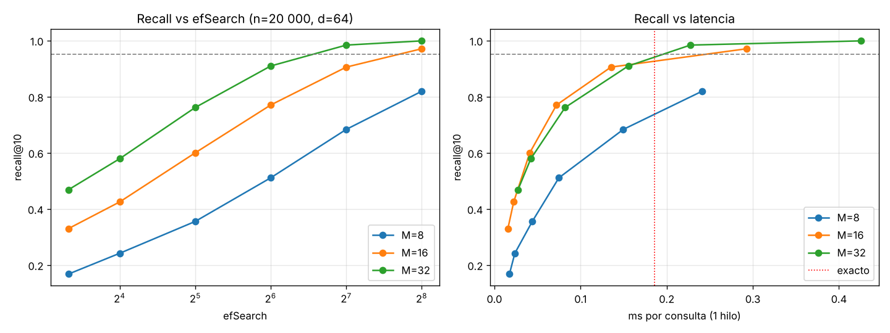

# Respuestas del workshop RAG

> **Cómo leer este archivo.** Las secciones de teoría (T1–T5) y el reto C1 están completas con resultados reales. Las tareas que llaman a NVIDIA NIM (A1–A4, B1–B5, C3–C6) tienen el código listo en los notebooks; cada celda imprime su tabla en Markdown. Donde dice **⏳ PENDIENTE**, pega la salida de la celda indicada y escribe el análisis con lo que observes.

---

# Bloque 0 · Teoría

## T1 · Cuántos nodos viven en cada capa

_Evidencia:_ cálculo a mano + simulación (código abajo).

**Cálculo a mano.** Con `mL = 1/ln(M)`, P(nivel ≥ k) = M⁻ᵏ. Con M = 16 y n = 1 000 000:

| Capa | Probabilidad | Nodos esperados |
|---|---|---:|
| ≥ 1 | 16⁻¹ = 1/16 = 0.0625 | 1 000 000 / 16 = **62 500** |
| ≥ 2 | 16⁻² = 1/256 ≈ 0.0039 | 1 000 000 / 256 ≈ **3 906** |
| ≥ 3 | 16⁻³ = 1/4096 ≈ 0.00024 | 1 000 000 / 4096 ≈ **244** |

**Simulación** (semilla 0):

```python
import numpy as np
M, n = 16, 1_000_000
levels = np.floor(-np.log(np.random.default_rng(0).random(n)) / np.log(M)).astype(int)
for k in (1, 2, 3):
    print(f"capa >= {k}: teórico {n*M**-k:,.1f}  simulado {(levels>=k).sum():,}")
```

```
capa >= 1: teórico 62,500.0  simulado 62,397
capa >= 2: teórico 3,906.2  simulado 3,937
capa >= 3: teórico 244.1  simulado 260
capa máxima simulada: 5
```

La simulación coincide con la teoría con errores de 0.2 %, 0.8 % y 6.5 %. El error crece en las capas altas porque son pocos nodos y el ruido relativo de una binomial es ~1/√(n·p) (para 244 nodos, ±6 %). La capa máxima es 5, cerca de log₁₆(10⁶) ≈ 5.

**Por qué conviene que haya pocos hubs arriba.** Cada capa tiene ~16 veces menos nodos que la de abajo, así que en las capas altas cada salto greedy cruza una fracción enorme del espacio: con unos pocos saltos por capa llegas a la zona correcta en O(log n) pasos. Si las capas altas tuvieran muchos nodos, el descenso tendría que recorrer casi tantos vecinos como la capa 0 y se perdería la ventaja de la jerarquía, además de gastar memoria en aristas redundantes.

## T2 · ef, k y el tamaño de la cola

_Evidencia:_ presentación «Búsqueda en HNSW» y reto C1.

1. **k = 10 con ef = 5.** La cola de candidatos de la capa 0 solo guarda los 5 mejores vistos, así que es imposible devolver 10: el algoritmo descarta candidatos que deberían estar en el top-10. Las librerías lo «arreglan» de forma distinta (hnswlib lanza error o usa `max(ef, k)`), pero conceptualmente la regla es **ef ≥ k**.
2. **Valor inicial.** Empezar con **ef = 2·k** y subirlo si el recall medido es insuficiente (la presentación da ef = 50–100 con k = 5–10 como rango típico en RAG). En C1 lo vi: con M=16 y datos aleatorios ef=64 da recall 0.77 y hace falta ef=256 para pasar de 0.95; con datos agrupados ef=10 ya da 0.97.
3. **ef se puede cambiar en producción sin reconstruir; ef_construction no.** `ef_construction` solo se usa al insertar para decidir con qué vecinos conectar cada nodo: queda «horneado» en las aristas del grafo y cambiarlo exige reindexar. `ef` es un parámetro de la consulta, no modifica el grafo, así que puedes ajustarlo en cada búsqueda (en C1 cambio `index.hnsw.efSearch` sobre el mismo índice ya construido).

## T3 · Inserción frente a búsqueda

_Evidencia:_ presentaciones «Inserción» y «Búsqueda».

| | Inserción | Búsqueda | Por qué |
|---|---|---|---|
| ¿Se sortea la capa? | **Sí**: l = ⌊−ln(U)·mL⌋ | **No**: siempre se entra por la capa más alta | El sorteo decide hasta dónde «vive» el nodo nuevo; una consulta no se guarda en el grafo, así que no necesita capa propia. |
| Valor de ef en las capas altas | **ef = 1** en las capas por encima de l (solo descender) | **ef = 1** en las capas L_max…1 | En ambos casos las capas altas solo sirven para acercarse rápido a la región correcta; basta con el mejor candidato. |
| Parámetro de la fase principal | **ef_construction** (de la capa l a la 0) | **ef** (solo en la capa 0) | En la inserción importa encontrar buenos vecinos para crear aristas de calidad en cada capa donde vive el nodo; en la búsqueda solo importa el resultado final en la capa 0, que tiene todos los nodos. |
| ¿Modifica el índice? | **Sí**: crea aristas (hasta M por capa) y poda conexiones de los vecinos | **No**: solo lee | La inserción construye el grafo; la búsqueda lo recorre. Por eso ef se puede cambiar en caliente y ef_construction no. |

En el notebook 03, `vectorstore.add_documents(all_docs)` dispara la **inserción** (cada chunk se convierte en vector y se hace *upsert*), y `retriever.invoke(pregunta)` dispara la **búsqueda** (embebe la pregunta y pide los k vecinos).

> Matiz que encontré: `QdrantClient(":memory:")` es el modo local del cliente de Python, que según su implementación hace búsqueda exhaustiva con NumPy en vez de construir un grafo HNSW. El servidor Qdrant sí construye HNSW. Con 150 chunks la diferencia de velocidad es irrelevante (C1 muestra que el exacto gana en datasets pequeños).

## T4 · El invariante de FAISSVectorStore

_Evidencia:_ presentación «FAISS explicado».

| Posición FAISS | Antes: `self.documents[i]` | Después de borrar B solo de la lista |
|---:|---|---|
| 0 | A | A |
| 1 | B | **C** |
| 2 | C | **D** |
| 3 | D | **— (no existe → IndexError)** |

El índice FAISS sigue teniendo 4 vectores y no sabe que B se borró. Una búsqueda que antes devolvía `[1, 2, 3]` (B, C, D) ahora se traduce como:

- `documents[1]` → **C** en lugar de B: **error silencioso** (devuelve un texto equivocado con apariencia válida).
- `documents[2]` → **D** en lugar de C: **error silencioso**.
- `documents[3]` → **IndexError**: la lista solo tiene 3 elementos, es el único que **lanza excepción**.

Lo peligroso son los dos errores silenciosos: el RAG citaría un chunk que no corresponde al vector que coincidió, y nadie se entera. Por eso existen bases vectoriales como **Qdrant**: guardan el *payload* (texto y metadata) **junto al vector**, bajo el mismo id, y gestionan borrados y actualizaciones de forma nativa, así que no hay dos estructuras paralelas que se puedan desincronizar.

## T5 · El costo de la fuerza bruta

_Evidencia:_ cuenta abajo y C1 (experimento 2).

- 1 000 000 vectores × 768 dimensiones = **7.68 × 10⁸** multiplicaciones por consulta.
- × 100 consultas/s = **7.68 × 10¹⁰ multiplicaciones por segundo** (77 mil millones).

Además del cómputo está la memoria: cada consulta recorre 10⁶ × 768 × 4 B ≈ 3.1 GB de vectores float32; a 100 consultas/s son **~307 GB/s** de ancho de banda, más de lo que da la RAM de un servidor típico. Y el costo crece linealmente con n: con 10 millones de documentos se multiplica por 10. En C1 lo medí: el exacto pasa de 0.2 ms (n=20 000) a 14.6 ms por consulta (n=500 000), 73 veces más lento para 25 veces más datos (el salto extra viene de que los vectores dejan de caber en caché).

**ANN:** se sacrifica la garantía de encontrar exactamente los k más cercanos (recall < 1) a cambio de búsquedas sublineales (≈ log n) y latencias de milisegundos que no explotan con el tamaño del corpus.

---

# Bloque A · App RAG empresarial

## A1 · Ejecuta la app RAG de punta a punta

_Evidencia:_ `evidencias/A1_gradio.png` · `notebooks/02b_rag_app_nvidia_nim_colab.ipynb`

⏳ PENDIENTE: ejecutar el notebook **original** (documentos de demostración) y llenar la tabla.

| # | Pregunta | Respuesta del RAG | Fuentes | ¿Correcta? |
|---:|---|---|---|:---:|
| 1 | ¿Cuál es el precio del plan Enterprise de CloudSync Pro? | | | |
| 2 | ¿Cuántos días pueden trabajar remotamente los empleados? | | | |
| 3 | ¿Qué pasa con los reembolsos mayores a $100? | | | |
| 4 | ¿Qué ocurre durante la primera semana de onboarding? | | | |
| 5 | (fuera de contexto) ¿Cuántos días de vacaciones tiene un empleado? | | | |

_Análisis:_ número de chunks del índice (N = …) y qué hizo el modelo con la pregunta 5.

## A2 · Tu propio corpus de documentos

_Evidencia:_ `data/company_documents.json` · `evidencias/A2_corpus.png` · celda «4b» del notebook 02b

**Corpus:** *Tostadora Altamira*, una tostadora de café de especialidad inventada en Envigado. 10 documentos con metadata `department` (ventas, logistica, servicio, produccion, recursos_humanos, finanzas) y `type` (pricing, policy, procedure). Tienen datos concretos y algunos parecidos a propósito (dos documentos hablan de aprobaciones por monto, dos de tiempos de entrega/despacho, dos de reembolsos) para que la recuperación no sea trivial.

**Chunking.** Los documentos miden entre 444 y 586 caracteres (promedio 514) y cada uno trata un solo tema en dos párrafos.

| chunk_size / overlap | chunks | Efecto |
|---|---:|---|
| 400 / 40 (original) | 21 | Casi todos los documentos se parten en 2; el segundo párrafo queda sin el tema del primero. |
| **600 / 60 (elegido)** | **10** | Un chunk por documento, coherente; con k=3 el contexto sigue siendo ≈1 500 caracteres. |

Elegí 600 porque con documentos cortos y temáticos partirlos solo diluye el embedding (un fragmento como «Se puede pausar hasta dos meses por año sin costo» pierde la palabra *suscripción*). Si el corpus tuviera manuales largos volvería a un tamaño menor.

⏳ PENDIENTE: pegar la salida de la primera celda de «4b».

| # | Pregunta | Respuesta del RAG | Fuentes (score) | Esperada | ¿Correcta? |
|---:|---|---|---|---|:---:|
| 1 | ¿Cuánto cuesta la libra de café Reserva? | | | $52.000 la libra | |
| 2 | ¿Hasta qué día puedo cancelar la suscripción sin que me cobren el mes siguiente? | | | Antes del día 25 | |
| 3 | ¿Qué descuento reciben los clientes mayoristas y cuándo pueden tener crédito? | | | 18 %; crédito a 30 días tras 6 meses | |
| 4 | ¿Qué pasa con un lote que obtiene menos de 82 puntos en la catación? | | | Pasa a la línea Clásica | |
| 5 | ¿Quién debe aprobar un gasto de viaje de $450.000? | | | Gerencia financiera | |
| 6 | ¿Venden máquinas de espresso para el hogar? | | | No está en los documentos | |
| 7 | ¿Cuál es el salario de un operario de tostión? | | | No está en los documentos | |

## A3 · Ingeniería del prompt (antes y después)

_Evidencia:_ celda «A3 · Prompt antes y después» del notebook 02b

**Diff del prompt:**

```diff
- Eres un asistente empresarial. Responde únicamente con información del contexto
- proporcionado. Si el contexto no contiene la respuesta, indica que no tienes esa
- información. Responde en español y de forma concisa.
+ Eres el asistente interno de Tostadora Altamira. Responde únicamente con información del CONTEXTO.
+ Reglas obligatorias:
+ 1. Cita el título exacto del documento que usaste entre corchetes, por ejemplo
+    [Política de devoluciones y garantía de frescura].
+ 2. Si el contexto no alcanza para responder, responde exactamente:
+    "No encuentro esa información en los documentos de Altamira." y no agregues nada más.
+ 3. Si la pregunta es ambigua, da la respuesta para cada caso que cubra el contexto.
+ 4. Máximo 3 oraciones, en español.
```

La regla 3 la agregué porque «¿Cuánto cuesta el envío?» tiene dos respuestas según el destino.

⏳ PENDIENTE: pegar la tabla que imprime la celda.

| Tipo | Pregunta | Antes | Después |
|---|---|---|---|
| fácil | ¿Cuánto cuesta la libra de café Reserva? | | |
| ambigua | ¿Cuánto cuesta el envío? | | |
| fuera de contexto | ¿Venden máquinas de espresso para el hogar? | | |

_Conclusión:_ ⏳ ¿qué regla tuvo más efecto (cita, frase fija, longitud) y cuál ignoró el modelo?

## A4 · Muestra el score de similitud en las fuentes

_Evidencia:_ `evidencias/A4_scores.png` · función `chat()` y celda «A4» del notebook 02b

Cambios: `build_pipeline` devuelve `(pipeline, chunks, vectorstore)` y `chat()` llama a `vectorstore.similarity_search_with_score(question, k=K)`; cada fuente se muestra con su score y con ✅ / ⛔ según supere `SCORE_THRESHOLD`.

⏳ PENDIENTE: pegar la tabla de la celda A4.

| Pregunta | Tipo | top-1 | top-2 | top-3 |
|---|---|---|---|---|
| ¿Cuánto cuesta la libra de café Reserva? | buena | | | |
| ¿Qué incluye la primera semana de un colaborador nuevo? | buena | | | |
| ¿Cuántos días tarda un envío a Bogotá? | buena | | | |
| ¿Venden máquinas de espresso para el hogar? | fuera | | | |
| ¿Quién ganó el mundial de fútbol de 2022? | fuera | | | |

_Umbral propuesto:_ ⏳ elegir un valor entre el **menor top-1 de las preguntas buenas** y el **mayor top-1 de las preguntas fuera de contexto**. Si los rangos se solapan, ningún umbral separa perfectamente y conviene dejarlo bajo y confiar en el prompt (frase fija).

---

# Bloque B · RAG sobre papers

## B1 · Ejecuta el RAG de papers y evalúa con el ground truth

_Evidencia:_ `notebooks/03_rag_workshop_papers_nvidia_nim_colab.ipynb` · celda «B1 · Tabla de resultados del quiz»

Chunks con la configuración base (900 / 120): Attention **55**, RAG **95**, total **150** (contados con el mismo splitter sobre el texto de MarkItDown).

Observación previa: MarkItDown pega muchas palabras de estos PDFs (`WeusedtheAdamoptimizer[20]withβ =0.9`). Eso puede afectar a los embeddings y obliga a que las comprobaciones por palabra clave ignoren espacios.

⏳ PENDIENTE: pegar la tabla y llenar las dos últimas columnas.

| # | Respuesta del RAG | ¿Correcta? | ¿Paper correcto? | Chunks recuperados |
|---|---|:---:|:---:|---|
| Q1 | | | | |
| Q2 | | | | |
| Q3 | | | | |
| Q4 | | | | |
| Q5 | | | | |
| Bonus | | | | |

## B2 · Experimentos con chunk_size, k y score_threshold

_Evidencia:_ celdas «B2» del notebook 03 (`build_store`, `build_chain`, bucle de configuraciones)

Número de chunks por configuración de chunking (ya medido localmente con el mismo splitter, overlap ≈ 13 %):

| chunk_size | overlap | Attention | RAG | Total |
|---:|---:|---:|---:|---:|
| 400 | 53 | 121 | 205 | 326 |
| 900 | 120 | 55 | 95 | 150 |
| 1500 | 200 | 38 | 58 | 96 |

⏳ PENDIENTE: pegar la tabla de 9 filas que imprime la celda. «Aciertos (auto)» usa palabras clave; revisa a mano los casos dudosos.

| Experimento | Valor | chunks en índice | chunks recuperados (prom.) | Aciertos | Fallos | Observación |
|---|---:|---:|---:|---:|---|---|
| chunk_size | 400 | 326 | | | | |
| chunk_size | 900 | 150 | | | | |
| chunk_size | 1500 | 96 | | | | |
| k | 3 | 150 | | | | |
| k | 5 | 150 | | | | |
| k | 8 | 150 | | | | |
| score_threshold | 0.15 | 150 | | | | |
| score_threshold | 0.25 | 150 | | | | |
| score_threshold | 0.40 | 150 | | | | |

_Conclusión (5–8 líneas):_ ⏳

## B3 · Preguntas trampa: ¿el RAG admite que no sabe?

_Evidencia:_ celdas «B3» del notebook 03

| # | Pregunta trampa | Por qué no está en los papers |
|---|---|---|
| 1 | What BLEU score did GPT-4 achieve on the WMT 2014 English-to-German task? | GPT-4 es de 2023; el paper solo reporta Transformer y modelos previos. |
| 2 | How does RAG compare against Llama 2 70B on Natural Questions? | Llama 2 es de 2023; RAG se compara con T5, DPR, REALM, BART. |
| 3 | How many GPUs were used to train RAG-Token, and how many days did training take? | Muy plausible porque el paper de Attention sí da GPUs y días; el de RAG no da duración de entrenamiento. Busca que el modelo mezcle datos de un paper con el otro. |

⏳ PENDIENTE: clasificar cada respuesta (admite que no sabe / inventa / mezcla).

**Diff del prompt** (celda `SYSTEM_PROMPT_B3`):

```diff
- Answer using only the supplied academic-paper excerpts. If the excerpts do not contain
- enough evidence, say so explicitly. Answer in the same language as the question and be
- concise. Mention the paper title supporting the answer.
+ You answer questions about two academic papers using ONLY the excerpts in CONTEXT.
+ Never use prior knowledge, even if you are confident.
+ Every number, model name or result you mention must appear literally in the excerpts.
+ If the question asks about a model, dataset or result that is not mentioned in the excerpts
+ (for example, models published after these papers), reply exactly:
+ "The papers do not contain this information." (or its translation to the question's language)
+ and then, in one sentence, what the excerpts DO say that is closest.
+ Answer in the same language as the question, be concise, and cite the paper title in brackets.
```

La celda también corre Q1 con el prompt nuevo como control, para comprobar que no lo vuelve demasiado restrictivo.

## B4 · Preguntas en español sobre papers en inglés

_Evidencia:_ celdas «B4» del notebook 03

⏳ PENDIENTE: pegar la tabla EN vs ES y los cosenos.

| # | Chunks EN (score) | Chunks ES (score) | Coincidencia | Calidad EN | Calidad ES |
|---|---|---|:---:|:---:|:---:|
| Q1 | | | /5 | | |
| Q3 | | | /5 | | |
| Q4 | | | /5 | | |

**Hipótesis.** `llama-nemotron-embed-vl-1b-v2` se entrena con datos multilingües, así que una pregunta y su traducción deberían caer cerca en el espacio de embeddings y recuperar casi los mismos chunks, con scores algo más bajos en español (el texto indexado está en inglés). Debería fallar más cuando la pregunta depende de un término técnico exacto que se traduce (por ejemplo «puntaje» vs *BLEU score* funciona porque BLEU se mantiene, pero «factor de escala» vs *scaling factor* depende de la alineación entre idiomas).

**Cómo la compruebo.** La segunda celda de B4 calcula el coseno entre cada pregunta EN y su versión ES, y lo compara con un control (dos preguntas EN distintas). Si coseno(EN, ES) es claramente mayor que el control y la coincidencia de chunks es ≥ 3/5, la hipótesis se sostiene. ⏳ resultado.

## B5 · Escribe tu propio quiz con ground truth

_Evidencia:_ celdas «B5 · Mi propio quiz» del notebook 03 (código + bloques `<details>`)

Los ground truth los verifiqué en el texto extraído de los PDFs.

| # | Pregunta | Ground truth | Sección | Respuesta RAG | ¿Correcta? |
|---|---|---|---|---|:---:|
| 1 | What optimizer and learning rate schedule were used to train the Transformer, and how many warmup steps? | Adam (β1=0.9, β2=0.98, ε=10⁻⁹); lr crece lineal 4000 pasos de warmup y luego decae ∝ 1/√step | Attention §5.3 | ⏳ | |
| 2 | What knowledge source does RAG use as its non-parametric memory, and how is it split and indexed? | Wikipedia dic-2018, fragmentos de 100 palabras, 21M documentos, índice MIPS en FAISS con HNSW | RAG §3 y §2.2 | ⏳ | |
| 3 (cruza ambos) | Which decoding strategies do the Transformer paper and the RAG paper use to generate their outputs? | Transformer: beam 4, α=0.6. RAG-Token: beam estándar; RAG-Sequence: Thorough / Fast Decoding | Attention §6.1 + RAG §2.5 | ⏳ | |

---

# Reflexión

## R1 · Reflexión final con tus datos

_Evidencia:_ tablas de A2–A4, B1–B5 y C1

⏳ PENDIENTE: responder con tus datos (mínimo 3 oraciones cada una). Guía de qué citar:

1. **Contexto insuficiente:** resultados de A2 (preguntas 6–7), A3 y B3 (¿admitió o inventó?, ¿qué cambió con el prompt?).
2. **Pregunta bonus:** fila Bonus de B1 y la comparación de C3/C5 (¿aparecieron los dos papers? ¿con MMR o con filtro?).
3. **Parámetros:** tabla de B2 y hit@k de C4.
4. **Separar embeddings y generación:** el índice se reutilizó con dos prompts distintos (A3, B3) sin volver a embeber; los embeddings se calculan una vez y el LLM se puede cambiar; costo y latencia muy distintos (1B vs 30B parámetros, 3B activos).
5. **Producción:** persistencia (C6), control de acceso (filtros por metadata como en C3, por departamento en A2), evaluación automática (C4), observabilidad (registrar pregunta, chunks, scores y respuesta, como hace la interfaz de A4) y costos (C1: ANN, cachear embeddings).

---

# Retos

## C1 · HNSW contra fuerza bruta con FAISS

_Evidencia:_ `notebooks/04_challenges.ipynb` (ejecutado) · `evidencias/C1_recall.png`

Configuración: d = 64, 200 consultas, k = 10, efConstruction = 100, datos uniformes en [0,1). Las búsquedas se midieron con 1 hilo (la construcción con 4) en el contenedor donde preparé el repo; en Colab los tiempos absolutos cambian pero las tendencias deberían mantenerse.

**Barrido M × efSearch (n = 20 000; exacto = 0.186 ms/consulta)**

| M | efSearch | recall@10 | ms/consulta | construcción (s) |
|---:|---:|---:|---:|---:|
| 8 | 10 | 0.168 | 0.017 | 0.60 |
| 8 | 64 | 0.510 | 0.075 | 0.60 |
| 8 | 256 | 0.819 | 0.241 | 0.60 |
| 16 | 10 | 0.329 | 0.016 | 0.84 |
| 16 | 16 | 0.425 | 0.022 | 0.84 |
| 16 | 32 | 0.599 | 0.041 | 0.84 |
| 16 | 64 | 0.770 | 0.072 | 0.84 |
| 16 | 128 | 0.905 | 0.135 | 0.84 |
| 16 | 256 | **0.971** | 0.293 | 0.84 |
| 32 | 10 | 0.468 | 0.027 | 1.06 |
| 32 | 64 | 0.909 | 0.155 | 1.06 |
| 32 | 128 | 0.983 | 0.227 | 1.06 |
| 32 | 256 | 0.998 | 0.426 | 1.06 |

(La tabla completa con los 18 puntos está en el notebook.)



**¿Qué efSearch para recall ≥ 0.95 con M = 16?** En el barrido, **ef = 256** (0.971); con 128 se queda en 0.905. Con M = 32 basta ef = 128 (0.983). Un M mayor da más aristas por nodo, así que cada paso explora más y necesita una cola menor, a cambio de más memoria y más tiempo de construcción (0.60 s → 1.06 s).

**¿Desde qué n HNSW es más rápido que el exacto? (M = 16)**

| n | efSearch | exacto ms/q | HNSW ms/q | aceleración | recall@10 | construcción (s) |
|---:|---:|---:|---:|---:|---:|---:|
| 20 000 | 64 | 0.201 | 0.105 | 1.9× | 0.776 | 0.9 |
| 20 000 | 128 | 0.201 | 0.146 | 1.4× | 0.910 | 0.9 |
| 20 000 | 256 | 0.201 | 0.301 | 0.7× | 0.970 | 0.9 |
| 100 000 | 64 | 1.798 | 0.190 | 9.5× | 0.528 | 5.9 |
| 100 000 | 128 | 1.798 | 0.307 | 5.9× | 0.713 | 5.9 |
| 100 000 | 256 | 1.798 | 0.639 | 2.8× | 0.848 | 5.9 |
| 500 000 | 64 | 14.610 | 0.339 | 43.1× | 0.340 | 45.1 |
| 500 000 | 128 | 14.610 | 0.543 | 26.9× | 0.492 | 45.1 |
| 500 000 | 256 | 14.610 | 0.961 | 15.2× | 0.634 | 45.1 |

- Con **n = 20 000** HNSW solo gana si aceptas recall < 0.95: con el ef necesario para 0.95 (256) es **más lento** que el exacto (0.30 vs 0.20 ms). A ese tamaño la fuerza bruta es un recorrido secuencial de 5 MB que cabe en caché y la SIMD lo hace muy rápido.
- Con **n = 100 000** HNSW ya es 3–10× más rápido, y con **n = 500 000** es 15–43× más rápido: el exacto crece linealmente (y peor, cuando los datos dejan de caber en caché) y HNSW casi no crece (0.29 → 0.96 ms con ef = 256).
- El precio: **con ef fijo el recall cae al crecer n** (ef = 256: 0.97 → 0.85 → 0.63). Para mantener recall ≥ 0.95 con 500 000 vectores aleatorios habría que subir ef o M bastante, y construir el índice ya tarda 45 s frente a 0 s del exacto.

**¿Por qué los datos aleatorios son un caso difícil?** En 64 dimensiones uniformes todas las distancias se concentran alrededor del mismo valor (maldición de la dimensionalidad): el vecino 10 está casi tan lejos como el 1000, así que no hay «vecindarios» claros que el grafo pueda aprovechar y el descenso greedy se equivoca a menudo. Lo comprobé con un tercer experimento (n = 20 000, M = 16), con datos agrupados: 50 clusters en un subespacio de 8 dimensiones dentro de R⁶⁴, con base y consultas de la misma distribución:

| datos | ef = 10 | ef = 16 | ef = 32 | ef = 64 |
|---|---:|---:|---:|---:|
| uniforme | 0.309 | 0.411 | 0.607 | 0.792 |
| agrupado | **0.966** | 0.990 | 0.998 | 1.000 |

Con estructura, ef = 10 ya da 0.97 de recall. Los **embeddings reales de texto** se parecen al caso agrupado: viven cerca de una variedad de dimensión intrínseca mucho menor que la nominal (temas, idiomas, estilos forman clusters). Por eso en la práctica HNSW con ef ≈ 50–100 suele dar > 95 % de recall, como dice la presentación, aunque con datos aleatorios necesité 256.

## C2 · Un tercer paper: el RAG que explica HNSW

No elegido.

## C3 · App Gradio para los papers con filtro por paper

_Evidencia:_ sección «C3» del notebook 03 · `evidencias/C3_gradio.png`

Implementación: `gr.Dropdown` con «Todos», «Attention Is All You Need» y «Retrieval-Augmented Generation». El filtro se aplica **dentro de Qdrant** con `models.Filter(must=[FieldCondition(key="metadata.source", match=MatchValue(...))])` pasado a `similarity_search_with_score`, así que se reciben hasta k chunks del paper elegido (filtrar después de recuperar podría dejar 0). Las fuentes se muestran con título, archivo, chunk y score.

⏳ PENDIENTE: pegar la salida de la celda de comparación (pregunta bonus con los tres filtros) y comentar: sin filtro, ¿qué paper domina? con filtro «Attention», ¿el modelo puede decir qué generador usa RAG o reconoce que no tiene la evidencia?

## C4 · Evaluación automática de la recuperación

_Evidencia:_ `eval/preguntas.csv` (10 preguntas) · sección «C4» del notebook 03

La función `hit_at_k` cuenta una pregunta como acierto si algún chunk recuperado viene de `fuente_esperada` **y** contiene `palabra_clave`. Comparo sin espacios ni mayúsculas porque MarkItDown pega palabras (`21Mdocuments`, `h=8`). Verifiqué que las 10 palabras clave aparecen en el texto extraído del paper correcto. Los retrievers no usan umbral, para medir solo el ranking.

⏳ PENDIENTE: pegar la tabla.

| chunk_size | hit@3 | hit@5 |
|---:|---:|---:|
| 400 | | |
| 900 | | |
| 1500 | | |

**Limitaciones de la métrica:**

1. **Palabra clave ≠ respuesta.** Un chunk puede contener «28.4» en otra tabla o contexto (falso positivo), o contener la respuesta parafraseada sin la palabra exacta (falso negativo). Y con chunks grandes es más fácil «acertar» por azar porque cada chunk tiene más texto: la métrica favorece a chunk_size grande aunque el contexto sea más ruidoso para el LLM.
2. **Mide recuperación, no la respuesta final.** hit@k = 100 % no garantiza que el LLM use el chunk correcto ni que no invente; tampoco mide la posición (un acierto en el puesto 5 vale lo mismo que en el 1, a diferencia de MRR o nDCG). Con 10 preguntas, además, cada pregunta mueve el resultado 10 puntos.

## C5 · MMR frente a similitud pura

_Evidencia:_ sección «C5» del notebook 03

Compara k=5 por similitud contra MMR (`fetch_k=20`, `lambda_mult=0.5`) en una pregunta amplia (Q2), una puntual (Q5) y una que cruza papers (Bonus). La redundancia es el coseno medio entre pares de chunks recuperados.

⏳ PENDIENTE: pegar la tabla y responder: ¿en qué pregunta ayudó MMR (esperado: Bonus/Q2, más papers distintos y menos redundancia) y en cuál empeoró (esperado: Q5, donde el dato está en 1–2 chunks y MMR los cambia por chunks diversos pero irrelevantes)?

## C6 · Persistencia del índice en disco

_Evidencia:_ sección «C6» del notebook 03

`QdrantClient(path="./qdrant_data")`: si la colección existe se reabre sin llamar la API de embeddings; si no, se indexa. La celda imprime el modo y el tiempo.

⏳ PENDIENTE:

| Operación | Tiempo (s) | Llamadas a embeddings |
|---|---:|---|
| Indexar (primera vez) | | 150 chunks |
| Reabrir tras reiniciar la sesión | | 0 (solo la pregunta) |

**Qué sigue faltando para producción:** el modo local de Qdrant bloquea la carpeta para **un solo proceso** (no hay concurrencia: dos workers no pueden abrirla a la vez; por eso la celda cierra el cliente anterior); no hay **control de acceso** ni autenticación; en Colab `./qdrant_data` desaparece si se recicla la máquina (hay que usar Drive o, mejor, un servidor Qdrant con volumen y **respaldos/snapshots**); y falta versionar la colección junto con el modelo de embeddings y el chunking, porque cambiar cualquiera de los dos invalida los vectores guardados.
